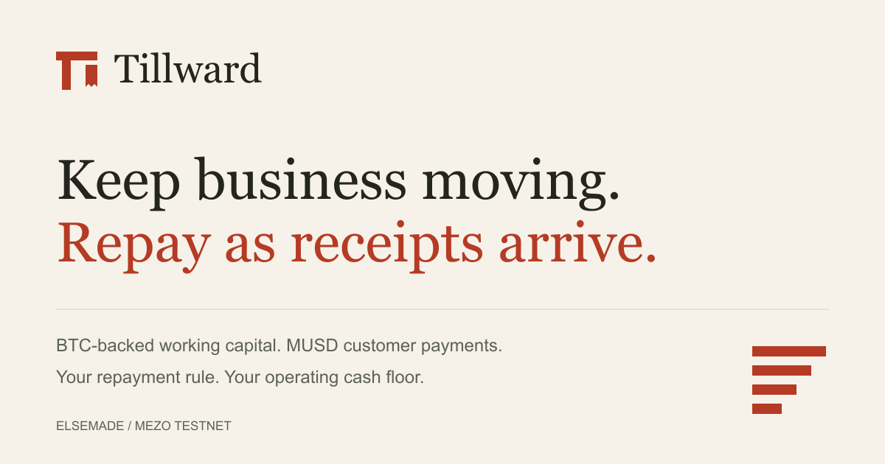

# Tillward

**BTC-backed working capital. Repay as receipts arrive.**

Tillward helps a BTC-holding business borrow MUSD for operating expenses and pay down its Mezo loan from customer receipts. The owner chooses a repayment percentage and a cash floor. Customers pay final-payment invoices in MUSD. Eligible allocations reduce the business account's native Mezo debt while operating cash remains available under the chosen rule.



## Try the product

**[Open Tillward](https://tillward.vercel.app)** · [Read the real testnet business](https://tillward.vercel.app/?account=0x5B4b9C9AD2E5c6Ef55A4186ad82580B61A67c6C5) · [Watch the two-minute pitch](https://tillward.vercel.app/pitch.html) · [Submission materials](submission/README.md)

- Explore the clearly labeled example workspace without connecting a wallet.
- Open the original testnet business using `?account=0x5B4b9C9AD2E5c6Ef55A4186ad82580B61A67c6C5` to read its real loan, invoices, repayment rule and activity.
- Select **Use testnet**, connect an EVM wallet, and follow onboarding to create your own account. Use Mezo testnet assets only.

The proof account belongs to a dedicated test wallet. Connecting another wallet gives read access, not authority to borrow or withdraw from it. Checkout links include the account and onchain invoice ID. The payer approves the exact MUSD amount and then confirms a separate payment.

## The receipt-to-repayment flow

1. Create a business account and supply test BTC to open a native MUSD loan.
2. Set the percentage of receipts to allocate toward repayment and the operating cash floor.
3. Create a final-payment invoice and share its checkout link.
4. The customer pays in MUSD. Tillward records the receipt and its repayment allocation.
5. The hosted keeper applies eligible allocations to that account's debt. Anyone can also trigger the same bounded settlement.
6. Inspect debt reduction and transaction evidence. The owner can top up MUSD, close the loan, and recover released BTC.

Protocol minimum debt can defer small repayments. Allocations remain visible until eligible. BTC collateral remains subject to the native protocol's liquidation and redemption rules. Only final, nonrefundable payments belong in this slice.

## What is implemented and verified

| Area | Evidence |
| --- | --- |
| Native integration | A business borrowed 2,000 test MUSD. A separate sample customer paid 500 MUSD and triggered 100 MUSD of native repayment. [Original proof](deployments/public-testnet-proof.json). |
| Browser journey | Rabby in Chrome completed account creation, borrowing, rule save, invoice approval/payment, repayment, MUSD top-up, full closure and recovery of 0.045 test BTC. [Browser proof](deployments/browser-wallet-proof.json). |
| Hosted repayment | Three factory accounts auto-enrolled, including one created after startup. A later 0.2 MUSD repayment retained the same transaction through restart. The recorded demo totals at block 16,302,866 are 502 MUSD collected and 100.4 MUSD repaid. [Enrollment proof](deployments/keeper-enrollment-proof.json). |
| Recovery and history | Pending hashes survive refresh. Receipt blocks advance the snapshot before pending state clears. Activity and invoice history are paginated without silently skipping failed ranges. |
| Operations | Hosted service, health checks, Telegram alerts, gas budgets, atomic signer journal, local backups and encrypted off-host capture. Workstation alert delivery verified. [Runbook and limits](docs/KEEPER_ENROLLMENT.md). |

These figures are testnet integration evidence. Sample funds came from faucet BTC and native test loans. They do not represent customer adoption or business revenue. The original demo loan remains open; the browser QA loan is closed.

## Run locally

Requires Node.js 22.12+ and npm. Node 24.14 was used for verification. Foundry is needed for Solidity tests.

```sh
npm ci
npm run dev
npm test
npm run build
npm run contracts
```

Open the development URL. Reading the public proof account requires RPC access but no wallet key. The default page uses labeled illustrative data. Failed live reads show an error rather than substituting that example.

`npm run fork:test` additionally requires the documented Mezo RPC path. It runs unchanged native lending code at block 12,684,025 and replays the captured oracle-precompile response because Foundry does not implement that precompile. It is separate from public-chain evidence.

Recorded release checks: 20 Foundry tests with 128 fuzz runs, 21 JavaScript tests, TypeScript and Vite production build, and dependency audit with zero findings. See [QA report](docs/QA_REPORT.md).

## Contracts and architecture

- `RevenueFactory` creates one account per owner and provides the checkout registry.
- `RevenueAccount` owns its native loan, invoices, receipt allocations and repayment rule. Owner and protocol addresses are immutable. It has no arbitrary-call or upgrade function.
- Withdrawals preserve the cash floor and pending repayment allocation. Policy changes, allocation release, borrowing and loan closure require the owner.
- Settlement can only repay that account's fixed native debt. The gas-only keeper cannot borrow, withdraw, change the rule or redirect funds.
- A shared transaction journal, nonce sequence and gas budget cover enrolled accounts. Pending signed transactions are reconciled before further signing.

Mezo testnet chain ID: `31611`.

Factory: [`0xaf90fe019f7303bb4720437dcfbafe1549474f36`](https://explorer.test.mezo.org/address/0xaf90fe019f7303bb4720437dcfbafe1549474f36).

Original proof account: [`0x5B4b9C9AD2E5c6Ef55A4186ad82580B61A67c6C5`](https://explorer.test.mezo.org/address/0x5B4b9C9AD2E5c6Ef55A4186ad82580B61A67c6C5).

See [architecture](docs/ARCHITECTURE.md), [approved product brief](docs/PROJECT_BRIEF.md), [keeper operations](docs/KEEPER_OPERATIONS.md), and [current status](docs/STATUS.md).

## Scope and limits

Tillward is a working Mezo testnet product. It has no mainnet deployment or independent security audit. Mainnet readiness remains [NO-GO](docs/MAINNET_READINESS.md).

Fiat collection, Shopify, other chains, refunds/disputes and yield are outside this build. Mezo RPC responses have shown inconsistent heads and delayed receipts. Fixed-block snapshots, bounded retries and explicit errors mitigate this dependency. Wallet-change/rejection and provider-failover testing is not exhaustive.

The workstation monitor needs that workstation online. A monitor outside both hosts and a full isolated service-restore drill remain open. The data-only encrypted restore rehearsal passed.

## License and attribution

Built by ElseMade. Original project code is [MIT licensed](LICENSE). Native protocol integration references [Mezo MUSD](https://github.com/mezo-org/musd) at commit `490ed984ba24ba6297986e8de1271abad4e8abe5`. See [NOTICE](NOTICE.md) for attribution and third-party licensing.
